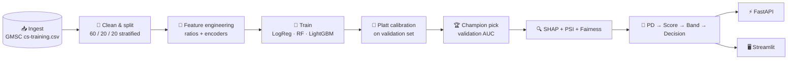
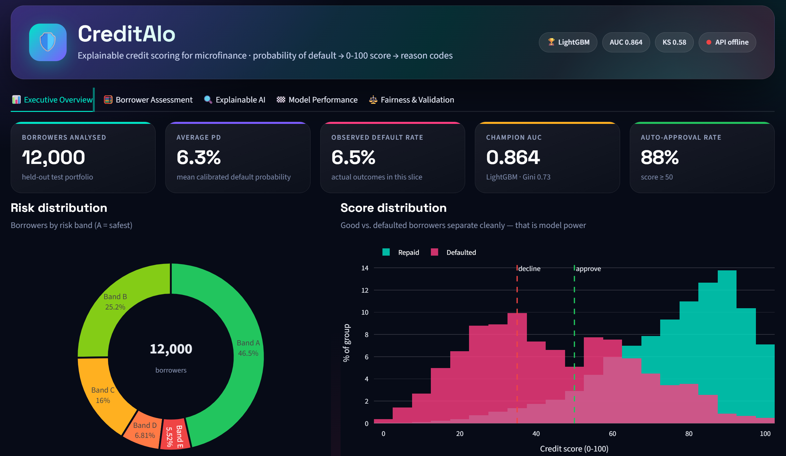
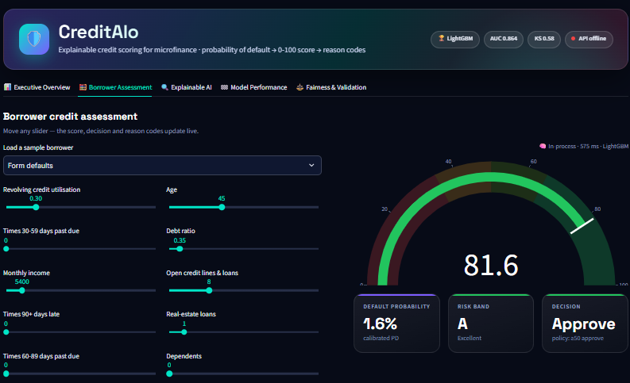
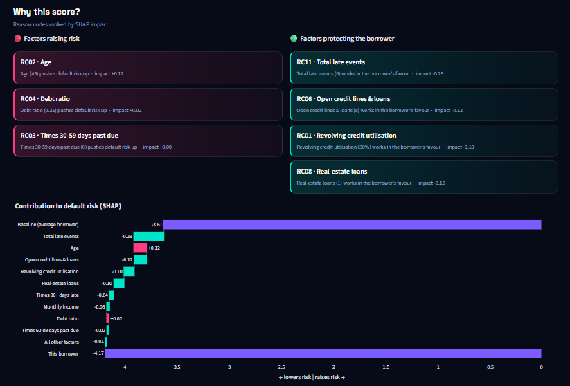
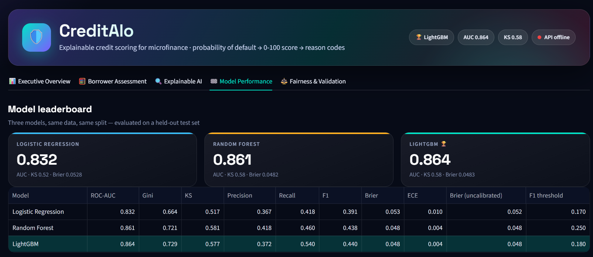
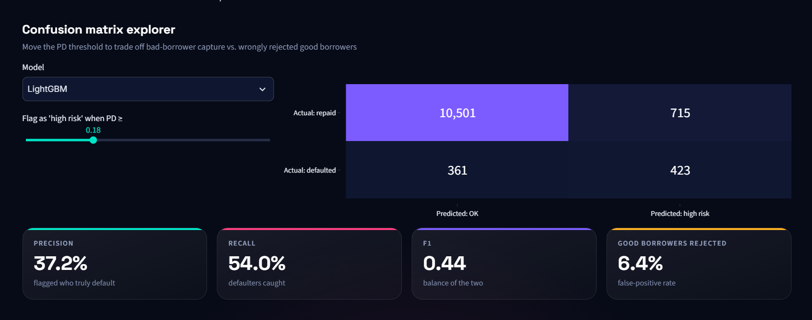
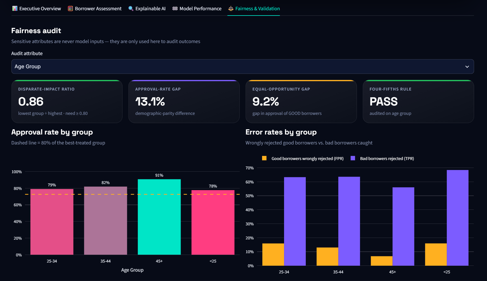

<div align="center">



# ক্রেডিট আলো
### ঋণের প্রতিটি সিদ্ধান্তে স্বচ্ছতার আলো

*"Alo" (আলো) means light in Bangla: a credit score you can see through, not a black box.*

<a href="https://git.io/typing-svg"></a>

<br/>


**[📖 Overview](#-project-overview) · [🧪 Results](#-results) · [🔬 Pipeline](#-ml-pipeline-breakdown) · [🖼️ Screenshots](#️-dashboard-tour) · [🚀 Quick Start](#-quick-start) · [🎤 Interview Notes](#-interview-ready-talking-points) · [📬 Author](#-author)**

</div>

---

## 📖 Project Overview

**CreditAlo MFI** is an end-to-end **credit risk platform for microfinance and digital lending**. It takes a borrower's profile, estimates the **Probability of Default (PD)**, converts it into a transparent **0–100 credit score**, and explains every decision in plain language, while keeping fairness and regulatory expectations in view.

### 🎯 Objectives

| # | Goal | How it is delivered |
|:-:|---|---|
| 1 | **Predict PD** | Logistic Regression, Random Forest and LightGBM, each calibrated |
| 2 | **Transparent 0–100 score** | Log-odds scaling: every doubling of good:bad odds adds 10 points |
| 3 | **Adverse-action and protective reason codes** | SHAP values turned into `RC01…` codes with plain-English text |
| 4 | **Fairness and compliance** | Disparate-impact ratio (four-fifths rule), equal-opportunity gap, TPR/FPR by group |
| 5 | **Production readiness** | FastAPI scoring service, Docker Compose, PSI drift monitoring, tests |

### 🗄️ Dataset

Real benchmark data: the Kaggle **[Give Me Some Credit (GMSC)](https://www.kaggle.com/c/GiveMeSomeCredit)** dataset (`cs-training.csv`). It contains borrower payment history, revolving utilization, debt ratio (DTI), age, number of dependents and delinquency counts, with a binary default flag as the target.

> GMSC is a consumer-credit benchmark, not a microfinance loan book. It is used here to prove the full pipeline on real default data. The code also supports `--data mfi_csv` for a real MFI portfolio.

### 🧰 Tech Stack

| Layer | Tools |
|---|---|
| **Language** | Python 3.11 |
| **ML & statistics** | LightGBM · Random Forest · Logistic Regression · scikit-learn · SHAP · Platt scaling · PSI · KS · Gini |
| **Backend** | FastAPI · Uvicorn · Pydantic |
| **Frontend** | Streamlit · Plotly |
| **DevOps** | Docker · Docker Compose · pytest · Git |

---

## 🧪 Results

Final numbers on the **untouched 20% test set** of GMSC (60/20/20 stratified split), taken from `artifacts/metrics.json`.

| Model | AUC | Gini | KS | Brier (calibrated) |
|---|:---:|:---:|:---:|:---:|
| Logistic Regression | 0.832 | 0.664 | 0.517 | 0.053 |
| Random Forest | 0.861 | 0.721 | **0.581** | **0.048** |
| 🏆 **LightGBM (Champion)** | **0.864** | **0.729** | 0.577 | **0.048** |

**How to read it**

- **LightGBM is the champion.** It was chosen on *validation* AUC, then reported on the test set, so the pick never saw the test data.
- **The tree models beat Logistic Regression** by about 3 AUC points (0.832 → 0.864), so non-linear patterns in delinquency and utilization matter.
- **Random Forest and LightGBM are close.** RF has a slightly higher KS (0.581 vs 0.577) and the Brier scores tie at 0.048. LightGBM wins on AUC and Gini, and its SHAP explanations are fast and exact via TreeSHAP.
- **Brier 0.048 on calibrated PDs** means the predicted probabilities are usable as real default rates, which the 0–100 score depends on.

---

## 🔬 ML Pipeline Breakdown



| Stage | What happens | Module |
|---|---|---|
| **1. Data ingestion** | Loads GMSC (or synthetic MFI / Taiwan / custom MFI CSV) into one schema | `data.py` |
| **2. Feature engineering** | Ratio features, missing-value handling, encoding | `features.py` |
| **3. Multi-model training** | Logistic Regression, Random Forest, LightGBM on the same split | `modeling.py`, `train.py` |
| **4. Calibration** | Platt scaling per model on a separate validation set; Brier before/after | `modeling.py` |
| **5. Validation** | AUC, Gini, KS, Brier on the test set; champion chosen on validation AUC | `metrics.py` |
| **6. Explainability** | SHAP on the champion; one-hot columns summed back to business features | `explain.py` |
| **7. Fairness audit** | Disparate-impact ratio, equal-opportunity gap, TPR/FPR by group | `fairness.py` |
| **8. Scoring policy** | PD → 0–100 score → band → decision → reason codes | `scoring.py` |
| **9. Serving** | `/score`, `/score/batch`, `/health`, optional API-key auth | `api.py` |
| **10. Monitoring** | PSI on the score and every input feature | `metrics.py` |

### 📐 Score Policy

```
score = 65 + (10 / ln 2) · ln( odds / odds₀ )         clipped to [0, 100]
odds  = (1 − PD) / PD          odds₀ = odds at PD = 5 %
```

| Band | Score | Decision |
|:---:|:---:|:---:|
| 🟢 A / B | 65–100 | ✅ Approve |
| 🟡 C | 50–65 | ✅ Approve |
| 🟠 D | 35–50 | 🕵️ Manual review |
| 🔴 E | < 35 | ❌ Decline |

Cut-offs live in `src/creditalo/config.py` so an institution can match them to its own risk appetite.

---

## 🖼️ Dashboard Tour

A 5-section interactive Streamlit dashboard sits on top of the same `Scorer` class as the API.

<table>
  <tr>
    <td width="50%" align="center"><br/><b>📌 Executive Overview</b><br/><sub>Portfolio risk KPIs at a glance</sub></td>
    <td width="50%" align="center"><br/><b>👤 Borrower Assessment</b><br/><sub>PD, score, band and decision for one applicant</sub></td>
  </tr>
  <tr>
    <td width="50%" align="center"><br/><b>🔍 Explainable AI</b><br/><sub>SHAP drivers and reason codes</sub></td>
    <td width="50%" align="center"><br/><b>🏆 Model Leaderboard</b><br/><sub>LogReg vs RF vs LightGBM</sub></td>
  </tr>
  <tr>
    <td width="50%" align="center"><br/><b>🧮 Confusion Matrix</b><br/><sub>Error trade-offs at the cut-off</sub></td>
    <td width="50%" align="center"><br/><b>⚖️ Fairness Audit</b><br/><sub>Approval and error rates across groups</sub></td>
  </tr>
</table>

---

## 🚀 Quick Start

<details open>
<summary><b>🪟 Windows (one-click)</b></summary>

1. Install **Python 3.11** and tick **"Add Python to PATH"**.
2. Clone the repo and open it in **VS Code**.
3. Double-click **`setup.bat`** (creates `.venv`, installs everything).
4. Double-click **`train.bat`** (prints AUC/KS/Brier and picks the champion).
5. Double-click **`run_all.bat`**: API at <http://127.0.0.1:8000/docs>, dashboard at <http://localhost:8501>.

</details>

<details>
<summary><b>⌨️ Terminal, real GMSC data</b></summary>

```powershell
python -m venv .venv
.venv\Scripts\activate
pip install -r requirements.txt
pip install -e .
python scripts/train.py --data gmsc --path data/raw/cs-training.csv
uvicorn creditalo.api:app --port 8000        # terminal 1
streamlit run dashboard/app.py               # terminal 2
```

</details>

<details>
<summary><b>🐳 Docker</b></summary>

```bash
docker compose up --build      # API :8000, dashboard :8501
```

</details>

### 🔌 Try the API

```powershell
curl.exe -X POST http://127.0.0.1:8000/score -H "Content-Type: application/json" -d "@docs/sample_request.json"
```

```json
{
  "applicant_id": "DEMO-001",
  "pd": 0.035,
  "score": 70.3,
  "band": "B",
  "decision": "Approve",
  "reason_codes": {
    "risk": [{ "code": "RC07", "text": "Requested loan amount (BDT 50,000) pushes default risk up" }],
    "protective": [{ "code": "RC10", "text": "Late payments (history) (0) works in the borrower's favour" }]
  }
}
```

> 🔐 Set `CREDITALO_API_KEY=secret` before starting the API to require an `X-API-Key` header.

---

## 🎤 Interview-Ready Talking Points

<details open>
<summary><b>📏 1. Why and how I used Platt calibration</b></summary>

- **Problem:** Random Forest and LightGBM output *scores*, not true probabilities. A "0.2" from a forest does not mean 20% of such borrowers default. The 0–100 score is built from odds, so wrong probabilities would give a wrong score.
- **Fix:** Platt scaling fits a small logistic regression, `p = 1 / (1 + exp(A·f(x) + B))`, on the model's raw output `f(x)`. Parameters `A` and `B` are learned on a **separate validation set**, never on the training or test data.
- **Evidence:** I report the **Brier score** after calibration (0.048 for LightGBM and RF, 0.053 for LogReg), and compare before vs after in the metrics file.
- **Why Platt and not isotonic:** Platt is smooth and stable on a modest validation set. Isotonic is more flexible but can overfit with limited data.
- **Honest caveat:** Platt assumes a sigmoid-shaped distortion. A reliability curve is the right way to check it holds.

</details>

<details open>
<summary><b>🔍 2. How SHAP reason codes work</b></summary>

- **Method:** `TreeExplainer` on the champion LightGBM gives exact SHAP values per applicant, in log-odds space. Each value says how much a feature pushed this borrower's risk up or down from the baseline.
- **From values to codes:**
  1. One-hot columns are **summed back to the original business feature** (e.g. all `region_*` columns become one driver).
  2. Features that push risk **up** become **adverse-action reasons**, the top ones are returned.
  3. Features that push risk **down** become **protective reasons**.
  4. Each feature maps to a code (`RC01…`) with a plain-English template, e.g. "Late payments (history) (0) works in the borrower's favour".
- **Why it matters:** Lenders often need to tell a declined applicant *why*. Reason codes make that routine and auditable, and the same logic runs in the API and the dashboard.
- **Calibration interaction:** SHAP explains the model's raw margin. Platt scaling is monotonic, so it does not flip the direction of any driver.
- **Honest caveat:** SHAP shows what the *model* relies on, not causation.

</details>

<details open>
<summary><b>⚖️ 3. Fairness audit: disparate impact and the four-fifths rule</b></summary>

- **Disparate-impact ratio (DIR):** approval rate of a group divided by the approval rate of the reference group. The **four-fifths rule** is a screening heuristic: a ratio **below 0.80** flags possible adverse impact.
- **Equal-opportunity gap:** the difference in **true-positive rate** between groups (are equally creditworthy people approved at similar rates?). I also show **TPR and FPR by group** so error trade-offs are visible, not just approval rates.
- **Design choice:** sensitive attributes are **not model inputs**. They are used only to audit the outputs.
- **What I would say about limits:** the four-fifths rule is a screening test, not proof of fairness or of legality. A flag means investigate (thresholds, proxy features, data coverage), and a pass does not close the question. On GMSC, **age** is the only demographic attribute available, so the audit there runs over age bands. A real MFI audit would add gender, region and similar fields.

</details>

<details>
<summary><b>🧠 4. Other questions to be ready for</b></summary>

- **Why LightGBM over Logistic Regression if scorecards are the industry norm?** Higher AUC/Gini on the test set, and SHAP recovers the explainability that scorecards give natively. Logistic Regression stays in the pipeline as an interpretable benchmark.
- **Why is RF's KS higher but LightGBM the champion?** Selection was on validation AUC. KS is a single-point separation measure, and the 0.004 gap is within noise.
- **How do you monitor it in production?** PSI on the score and on each input feature. A common rule of thumb: below 0.10 stable, 0.10–0.25 investigate, above 0.25 significant shift.
- **What is the main limitation?** GMSC is consumer credit, not MFI group lending. Next step would be out-of-time validation on a real MFI book, split by disbursement date.

</details>

---

## 🧱 Project Layout

```
creditalo-mfi/
├── src/creditalo/   config · schemas · data · features · modeling · metrics · explain · fairness · scoring · train · api
├── dashboard/       app.py (Streamlit) · tl_theme.py (CSS + Plotly theme)
├── scripts/         train.py (CLI)
├── tests/           unit + API contract tests
├── docs/            real-data guide · assets/ (screenshots)
├── Dockerfile · docker-compose.yml
└── setup.bat · train.bat · run_all.bat · test.bat
```

---

## ⚠️ Limitations

- GMSC is a **consumer-credit benchmark**, so metrics show pipeline quality, not performance on a microfinance portfolio.
- No out-of-time split yet. With a real MFI book, split by disbursement date.
- Score cut-offs are illustrative and should be set with the lender's loss/profit economics.
- The fairness audit is a screening tool, not a legal compliance guarantee.

## 🗺️ Roadmap

- [ ] Out-of-time validation on a real MFI loan book
- [ ] Scheduled PSI drift report
- [ ] Model card export
- [ ] Cloud deployment of the API and dashboard

---

## 📬 Author

<div align="center">

**Namira** · CSE Graduate, AUST · Dhaka, Bangladesh

[](https://github.com/NamTas)
[](https://linkedin.com/in/namtas)
[](mailto:tas.nam.03@gmail.com)

⭐ *If you found this useful, a star on the repo means a lot!*


</div>
